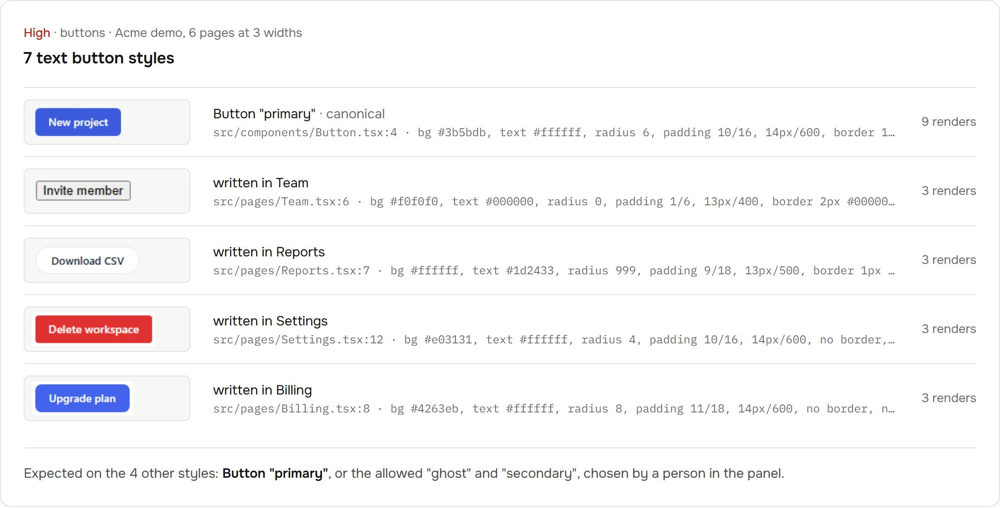
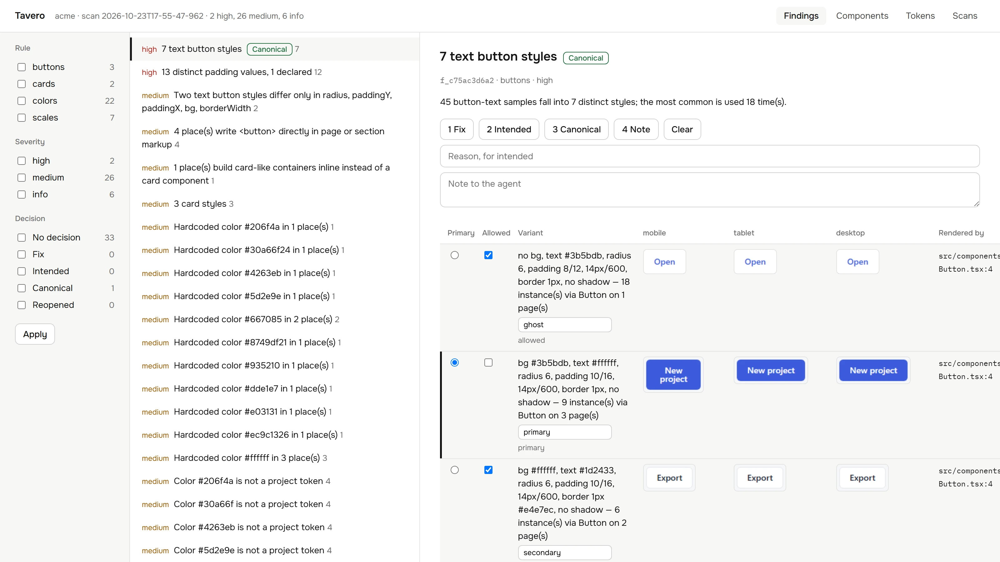

<p align="center">
  
</p>

<h1 align="center">Tavero</h1>

<p align="center">
  Keep the UI your agent writes consistent.
</p>

<p align="center">
  <a href="https://github.com/baccaraaa/tavero/actions/workflows/ci.yml"></a>
  <a href="LICENSE"></a>
  
  
</p>

Tavero scans your running React app, finds drift in buttons, cards, colors and spacing, and gives your coding agent each fix with the file, the line and the token to use. It runs on your machine, as a CLI, an MCP server for Claude Code, Cursor, Codex and other agents, and a local panel where you decide what is intended.

<p align="center">
  
</p>

<sub>A real finding from the Acme demo in this repository (`demo/acme`): six pages scanned at three widths.</sub>

## How it works

1. **Scan.** Tavero opens your dev server in Chromium at mobile, tablet and desktop widths, with your login if the app needs one.
2. **Attribute.** Every visible element is mapped to the React component and the source line that rendered it, from React's own dev-mode data. Nothing is added to your project.
3. **Find.** Four rules compare what renders with your tokens and with itself: buttons, cards, colors and scales.
4. **Fix.** Each finding is a task: what, where (file:line), the current value, and the token or component expected. Your agent fixes it, rescans one route in seconds, and checks that the finding is resolved.

## Quick start

Node 20 or later, a Vite or Next app on React 19 that runs in dev mode.

```bash
npm i -D tavero
npx playwright install chromium                      # once per machine
npx tavero login --url http://localhost:5173/login   # once, if the app has a login
npx tavero scan --url http://localhost:5173
npx tavero findings
```

```
id            sev     rule     decision  title                                                         evidence
f_c75ac3d6a2  high    buttons            7 text button styles                                          7
f_36cb934b5e  high    scales             13 distinct padding values, 1 declared                        12
f_94269275c1  medium  buttons            Two text button styles differ only in radius, paddingY, pa…   2
f_057122e1f9  medium  buttons            4 place(s) write <button> directly in page or section mark…   4
… 30 more, use --page 2
```

```bash
npx tavero finding f_ff30adc07c   # evidence: file:line, current value, expected token, crops
npx tavero context                # a ~1,500-token brief of the design system for an agent
npx tavero report                 # a self-contained HTML report
```

Tavero writes only to `<project>/.tavero/`. Every read command takes `--json`, and text output is capped at 20 rows so it fits an agent's context.

## Use it from your agent

`tavero mcp` is an MCP server on stdio with nine tools. Print the config for your client and paste it where it says:

```bash
npx tavero mcp --print-config claude       # Claude Code: .mcp.json
npx tavero mcp --print-config cursor       # .cursor/mcp.json
npx tavero mcp --print-config codex        # .codex/config.toml
npx tavero mcp --print-config gemini       # .gemini/settings.json
npx tavero mcp --print-config antigravity  # .agents/mcp_config.json
npx tavero mcp --print-config vscode       # .vscode/mcp.json (GitHub Copilot)
npx tavero mcp --print-config windsurf     # ~/.codeium/windsurf/mcp_config.json
```

Then paste [`docs/AGENTS.snippet.md`](docs/AGENTS.snippet.md) into `AGENTS.md`, `CLAUDE.md` or `GEMINI.md`, so the agent reads the design context before writing UI. [`SKILL.md`](SKILL.md) is an Agent Skill with the full workflow.

A recorded run of Claude Code on the Acme demo, with no shell, 29 seconds:

```
› tavero_context
  Action button is Button from src/components/Button.tsx (props: variant)
› tavero_findings rule=colors
  f_ff30adc07c  Color #4263eb is not a project token
› tavero_finding f_ff30adc07c
  src/app.css:33  literal #4263eb in source
  expected  --acme-primary #3b5bdb (ΔE 3.5)
  edit src/app.css:33  background: #4263eb → var(--acme-primary)
› tavero_scan routes=/billing rules=colors
› tavero_diff
  resolved  f_ff30adc07c  Color #4263eb is not a project token
  resolved  f_18862a0332  Hardcoded color #4263eb in 1 place(s)
  new  0
```

| Tool | Use |
|---|---|
| `tavero_context` | design-system brief; call before writing UI |
| `tavero_findings`, `tavero_finding` | problems, worst first; one problem with evidence, the expected value and the exact rescan call |
| `tavero_scan` | scan the app; after a fix, only the touched `routes` and `rules`. Streams progress, cancellable |
| `tavero_diff` | resolved, new and unchanged findings since the previous scan |
| `tavero_components`, `tavero_component`, `tavero_show`, `tavero_tokens` | inventory, crop paths, tokens |

## Rules

| Rule | Reports |
|---|---|
| `buttons` | distinct text and icon button styles with the components that render them, near-duplicate pairs, `<button>`s written outside button components |
| `cards` *(preliminary)* | distinct card styles, near pairs, card-like containers built inline |
| `colors` | colors outside your tokens with the nearest token and ΔE, Tailwind default colors in a project with its own palette, near-identical pairs, hardcoded literals with file and line |
| `scales` | radius, padding, gap, font size, weight and shadow values off the scale your tokens declare |

## Decide what is intended

```bash
npx tavero ui --open   # http://127.0.0.1:4747
```

<p align="center">
  
</p>

A local panel for the person behind the agent. Go through the findings with the keyboard and decide. The agent sees each decision on its next call, without a rescan.

| Decision | What the agent sees |
|---|---|
| Fix | the finding comes first, marked as confirmed work |
| Intended | hidden until the finding gains new places |
| Canonical | on button and card variants: the reference variant and allowed ones, optionally named ("primary", "ghost"); the others get it as `expected` |
| Note | a message delivered with the finding |

Decisions are stored in `.tavero/decisions.json`, keyed by stable finding ids. Commit it to share them with your team and its agents. `npx tavero ui --export ./panel` writes a static, read-only copy of the panel.

## Requirements and limits

- React 19 in dev mode, on Vite or Next (App Router, Turbopack). React 18 keeps different debug data and is not supported yet.
- Tokens are read from CSS custom properties and Tailwind 3 or 4 themes.
- Card detection is heuristic, so the `cards` rule is marked preliminary.
- Tavero runs locally and sends nothing anywhere. There is no account and no telemetry.

## Development

```bash
npm ci
npx playwright install chromium
npm test             # unit and Playwright runtime tests; starts the test apps itself
npm run typecheck
npm run build
```

The website lives in [`site/`](site/) (Next.js static export). `npm run site:install && npm run site:dev` runs it; `npm run site:audit` runs its gates: Tavero on the site itself with 0 high and medium findings, Lighthouse, axe and three widths.

```
src/
  core/      scan orchestration, aggregates, query API, decisions, diff, stable ids
  project/   framework detection
  static/    tokens, Tailwind theme and palette, hardcoded colors, component index
  runtime/   dev server, session, crawl, in-page collector, attribution, crops
  rules/     signatures and the four rules
  context/   the agent-facing brief
  report/    HTML report
  mcp/       MCP server, tools, client configs
  ui/        local panel and static export
  cli/       the command line
demo/acme/   a small dashboard with deliberate drift, used by tests and the website
test/        unit and runtime tests with mini Vite and Next apps
design/      design tokens shared by the panel and the website
site/        the website
```

See [CONTRIBUTING.md](CONTRIBUTING.md) before opening a pull request.

## License

[MIT](LICENSE)
